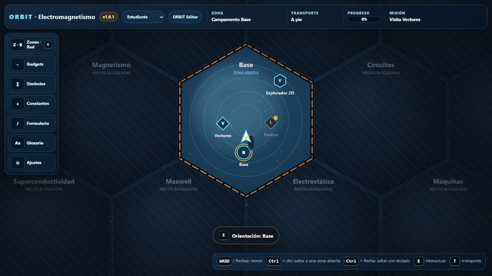
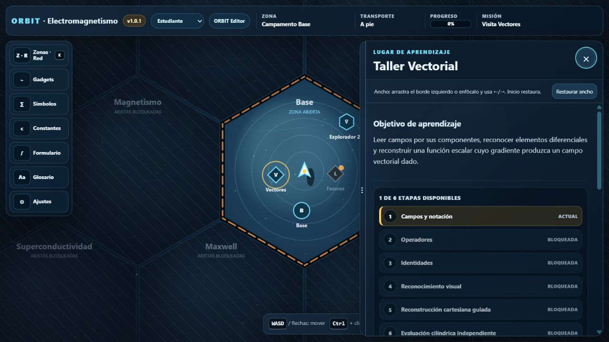
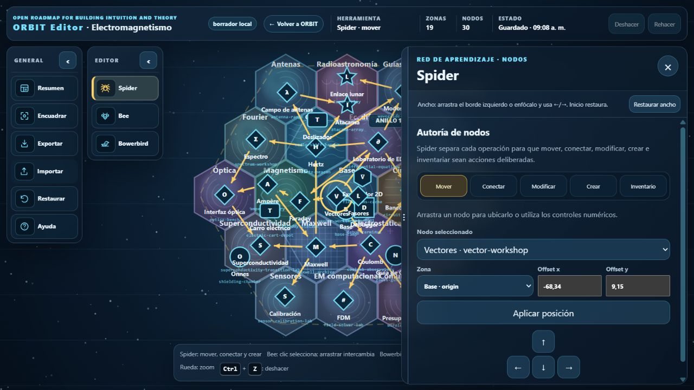

#  ORBIT

**Open Roadmap for Building Intuition and Theory**

Explora un mundo 2D y aprende resolviendo lecciones y misiones. Tu progreso en la **Red de
aprendizaje** abre nuevas zonas del mapa. La versión alfa incluye una ruta de
**Electromagnetismo** con actividades y herramientas interactivas.

## Descargar e instalar en Windows

1. Descarga el [instalador para Windows](https://github.com/JoaquinDiazM/ORBIT/releases/latest/download/orbit-windows-x64-setup.exe) para Windows 10 u 11 de 64 bits.
2. Abre el archivo y sigue el asistente. Luego busca **ORBIT** en el menú Inicio.
3. Pega el enlace HTTPS de tu curso y pulsa **Abrir ORBIT**. Inicia sesión con el alias y la
   contraseña que te entregaron.

Para actualizar, abre **Servidor y actualizaciones** desde la ventana del curso, pulsa
**Buscar actualizaciones** y, si hay una nueva versión, elige **Instalar y reiniciar**.
También puedes abrir el enlace de tu curso directamente en el navegador.

- [Guía de uso](docs/USER_GUIDE.md)
- [Guía para administrar un servidor](README_ADMIN.md)
- [Versiones y descargas](https://github.com/JoaquinDiazM/ORBIT/releases)

Ver capturas de ORBIT y del Editor en 1.0.1

El código se distribuye bajo [MIT](LICENSE) y el contenido original bajo
[CC BY-SA 4.0](LICENSE-CONTENT.md). Consulta la [guía de contribución](CONTRIBUTING.md),
el [registro](ORBIT_UPDATES.md) y el [historial de cambios](docs/UPDATES_HISTORY.md).
