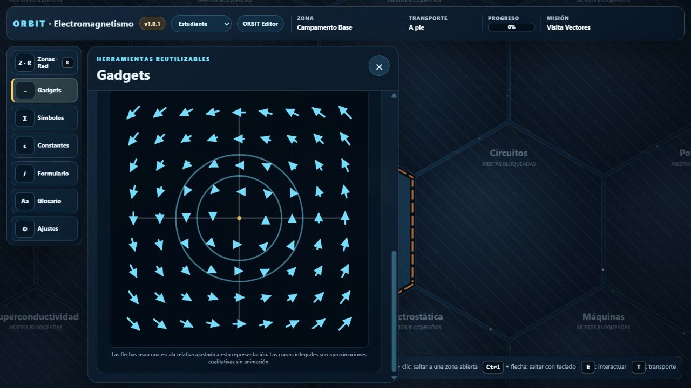
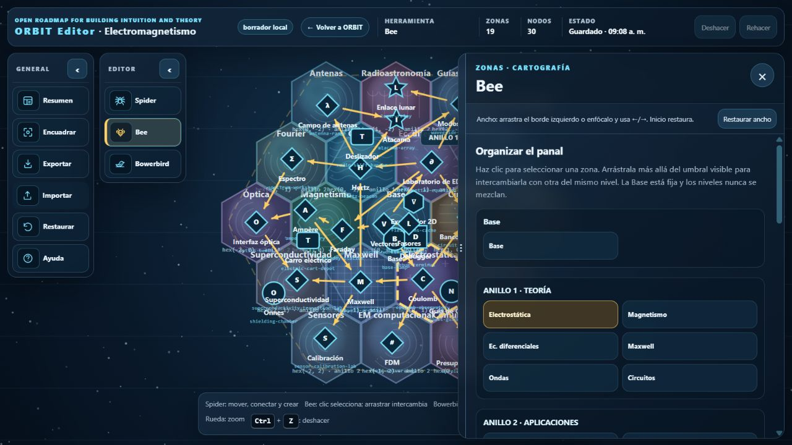

#  ORBIT

**Open Roadmap for Building Intuition and Theory**

ORBIT es un recurso educativo abierto para construir intuición y teoría mediante actividades
universitarias y exploración libre en un mundo 2D. Una **Red de aprendizaje** conecta lecciones
y misiones; su progreso abre regiones del mapa sin restringir el movimiento a nodos o caminos.

**Versión 1.1.1 alfa.** La ruta demostrativa es **Electromagnetismo**, dirigida a quienes
ya conocen cálculo, álgebra lineal y física clásica. Su contenido es provisional y no equivale
a un curso completo revisado.

La primera ruta nace de la experiencia docente del autor en EL3103 Electromagnetismo Aplicado
de la Universidad de Chile. ORBIT es independiente: no redistribuye evaluaciones, soluciones
ni material docente restringido. La historia de la ciencia sirve para explicar la necesidad
de nuevas ideas, subordinada a los prerrequisitos y al aprendizaje.

## Modo estático

- **ORBIT:** movimiento con teclado, navegación Global/Directa, ejercicios con retroalimentación,
  referencias y Gadgets. Estudiante, Docente y Debug conservan avances locales separados.
- **ORBIT Editor:** Spider organiza la Red y edita la fuente académica; Bee organiza las zonas;
  Bowerbird configura su apariencia. Incluye preview, historial e importación/exportación.
- **Aplicación local de una edición:** el desarrollador valida y aplica el borrador durante
  mantenimiento, con respaldo y recuperación. Exportar un JSON no publica el curso.
- **Distribución estática:** el build funciona sin backend ni cuentas; el repositorio incluye
  un workflow opcional de GitHub Pages.

Los perfiles seleccionables pertenecen al modo local. El servidor docente aplica los permisos
de las cuentas online por curso.

## Probar el servidor docente

1. El responsable del servidor obtiene el paquete portable e instala Node.js 24 en su máquina
   Windows o Linux siguiendo la [guía del servidor](docs/SERVER_GUIDE.md).
2. El docente prepara su curso en **ORBIT Editor offline**, creando contenido o importando una
   plantilla para adaptarla. La plantilla incluida es demostrativa; no es Electromagnetismo completo.
3. El administrador inicia el servidor desde una terminal, crea el docente y le asigna un curso.
   El enlace sirve para ORBIT y ORBIT Editor **online**; el docente importa allí su borrador.
4. El docente crea las cuentas y entrega a cada estudiante el enlace, alias y contraseña. El estudiante
   ingresa con esos datos; no hay registro abierto. Cada docente administra sus cursos y
   estudiantes, con una cuenta administradora separada para el servidor.
5. El estudiante aprende en ORBIT y el docente consulta un monitor básico de avance y
   finalización de actividades, sin recopilar respuestas ni intentos para seguimiento.
   **Owl** administra estudiantes del curso. Cada cuenta estudiantil pertenece a un solo curso.
6. El docente prepara borradores en su dispositivo y publica únicamente en mantenimiento.
   El avance se conserva; las incompatibilidades requieren una decisión explícita.

Si la red universitaria exige VPN, los participantes se conectan a ella antes de abrir el enlace
HTTPS. El estudiante puede preparar este dispositivo para estudiar sin conexión y sincronizar
después. Es una función distinta del Editor offline usado para preparar contenido.

La alfa está aprobada tras la prueba manual del mantenedor. El piloto ampliado de 10 estudiantes,
2 docentes y 2 cursos plantilla queda pendiente. Consulta el [informe de UPD-027](docs/reviews/UPD-027.md)
y la [hoja de ruta](docs/ROADMAP.md).

La [guía del servidor](docs/SERVER_GUIDE.md) explica cómo preparar el paquete portable. Cuando
esté adjunto a una release de GitHub, también se podrá obtener desde
[Descargas de ORBIT](https://github.com/JoaquinDiazM/ORBIT/releases). Los estudiantes solo
necesitan el enlace de su docente y la cuenta que reciban.

## Ejecutar el repositorio en modo estático

Requisito del repositorio: Node.js 24 o posterior.

```bash
git clone https://github.com/JoaquinDiazM/ORBIT.git
cd ORBIT
npm ci
npm run dev
```

Abre **[ORBIT](http://127.0.0.1:4173/)** o
**[ORBIT Editor](http://127.0.0.1:4173/editor.html)**. En PowerShell puedes usar `npm.cmd` si
el wrapper `npm.ps1` está bloqueado, sin cambiar la política del sistema.

El origen local es fijo: `http://127.0.0.1:4173`. Si está ocupado, identifica el servicio;
no uses otro puerto ni detengas procesos ajenos. `dev` permite editar y validar, pero bloquea
**Aplicar**. Para aplicar una edición, sigue la [guía del Editor](docs/EDITOR_GUIDE.md).
Los comandos y el despliegue estático se explican en [Desarrollo](docs/DEVELOPMENT.md).

## Documentación

| Necesidad | Referencia |
|---|---|
| Aprender a usar ORBIT y sus controles | [Guía de uso](docs/USER_GUIDE.md) |
| Instalar y operar el servidor docente | [Guía del servidor](docs/SERVER_GUIDE.md) |
| Crear o modificar contenido académico | [Editor](docs/EDITOR_GUIDE.md), [autoría](docs/CONTENT_AUTHORING.md) y [sintaxis de fuente](docs/CONTENT_SOURCE_GUIDE.md) |
| Contribuir o iniciar una sesión de agente | [Contribuir](CONTRIBUTING.md), [reglas](AGENTS.md) e [inicio para agentes](docs/CODEX_START_HERE.md) |
| Comprender la implementación | [Arquitectura](docs/ARCHITECTURE.md), [mundo y Red](docs/WORLD_AND_KNOWLEDGE_DESIGN.md), [ADR](docs/decisions/README.md) |
| Preparar y comprobar cambios | [Desarrollo](docs/DEVELOPMENT.md), [QA](docs/QA_CHECKLIST.md), [Debugger](docs/DEBUGGING.md) |
| Entender el criterio académico | [Principios pedagógicos](docs/PEDAGOGICAL_PRINCIPLES.md), [esqueleto curricular](docs/CURRICULUM_SKELETON.md), [fuentes](docs/RESEARCH_REFERENCES.md) |
| Planificar próximas versiones | [Hoja de ruta](docs/ROADMAP.md) y [cola de actualizaciones](ORBIT_UPDATES.md) |
| Consultar lo publicado | [Changelog](CHANGELOG.md), [fichas y evidencia histórica](docs/UPDATES_HISTORY.md) |

El mantenedor coordina propuestas, pruebas y aprobaciones en el chat de Codex. El agente
registra las decisiones en `ORBIT_UPDATES.md`. Las contribuciones externas pueden usar issues
y pull requests. Ejecuta `npm run check` antes de entregar un cambio.

## Capturas de referencia

Las cinco capturas muestran la versión publicada **1.0.1**. Consulta su
[procedencia y protocolo](docs/screenshots/README.md).

<details>
<summary>Ver el mapa, la lección, el gadget y el Editor en 1.0.1</summary>







</details>

## Licencias

- Código: [MIT](LICENSE).
- Contenido pedagógico original y documentación: [CC BY-SA 4.0](LICENSE-CONTENT.md), salvo
  indicación distinta. Las referencias y adaptaciones declaradas conservan su procedencia en
  la [bibliografía](docs/references/references.bib).
- KaTeX: MIT, distribuido localmente desde la dependencia fijada.
- Audio: tres recursos de Freesound CC0 1.0, un recurso de RunnerPack CC BY 4.0 con antecedente
  Sampling+ 1.0 y dos contribuciones de ORBIT bajo MIT. Consulta la
  [atribución individual](public/assets/audio/ATTRIBUTION.md).
- El material docente EL3103 se reconoce como contexto, sin permiso de redistribución de sus
  PDF, tablas, ejercicios o soluciones. Los recursos externos conservan sus propias condiciones.
